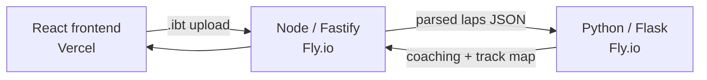

# RaceX

**Corner-by-corner driving coaching from iRacing telemetry.**

Upload an iRacing `.ibt` telemetry file and RaceX works out where you're losing time. It parses thousands of telemetry samples per lap, finds every corner, and compares your fastest lap against how you *usually* drive each corner, then tells you what to change on braking, throttle and gear.

**Live:** [racex-six.vercel.app](https://racex-six.vercel.app)

## How It Works

1. **Parse the session.** The `.ibt` file is decoded into per-sample telemetry (speed, brake, throttle, steering, yaw rate, gear, GPS position, lap distance) and split into laps at each start-line crossing.
2. **Keep the clean laps.** Out-laps, in-laps and anything more than 4 seconds off your fastest lap (spins, traffic, offs) are discarded.
3. **Find the corners.** A corner starts when the car's yaw rate (how fast it's rotating) rises above a threshold and ends when it drops back. Short wiggles are filtered out as noise, and nearby rotations in the same direction are merged into one corner, but never across a change of direction (so chicanes stay as separate corners).
4. **Attach inputs to each corner.** Each corner gets its brake zone (where you braked and how hard), throttle lift, minimum speed and lowest gear.
5. **Build a "typical" lap.** Rather than comparing against one other lap, RaceX takes the **median** of every corner across all your other clean laps. One lucky or messy lap can't skew the comparison.
6. **Coach.** Your fastest lap is matched corner by corner against the median lap, and RaceX writes plain-language tips. For example:
   > Braking 7 meters late at 82% typical pressure — overshooting compared to your usual braking. Brake earlier to carry more speed through the corner.
7. **Show it on the map.** The track is drawn from GPS data with each corner marked, next to the time gained or lost there.

## Architecture



| Service | Folder | Stack | Job |
|---|---|---|---|
| Frontend | `src/` | React 19, TypeScript, Vite, Tailwind | Upload the file, show the track map and per-corner coaching |
| Parser | `server-js/` | Node, Fastify | Receive the upload, decode `.ibt` telemetry, split and clean laps |
| Analysis | `server-py/` | Python, Flask, gunicorn | Corner detection, median reference lap, coaching |

The telemetry decoding uses my fork of [`ibt-telemetry`](https://github.com/jacobduck99/ibt-telemetry).

The parser is in Node because the `.ibt` decoding library is JavaScript. The analysis is in Python because it's numerical work that's easier to write and test there.

## Running Locally

Requires Node.js and Python 3.

**1. Analysis service** (port 5000)

```bash
cd server-py
python3 -m venv .venv && source .venv/bin/activate
pip install -r requirements.txt
python app.py              # FLASK_DEBUG=1 python app.py for debug mode
```

**2. Parser service** (port 3000)

```bash
npm install
echo "PY_BACKEND_URL=http://127.0.0.1:5000" > server-js/.env
npm run dev:server
```

**3. Frontend** (port 5173)

```bash
echo "VITE_API_URL=http://localhost:3000" > .env
npm run dev
```

Open http://localhost:5173 and upload an `.ibt` file from `Documents/iRacing/telemetry`. A session needs at least two clean laps.

## Tests

```bash
# Analysis: corner detection, merging, median reference lap
cd server-py && python -m pytest

# Parser: lap splitting, lap cleaning, median helper
cd server-js && npm test
```

## Configuration

| Variable | Where | Purpose |
|---|---|---|
| `VITE_API_URL` | `.env` (frontend) | URL of the parser service |
| `PY_BACKEND_URL` | `server-js/.env` | URL of the analysis service |
| `FLASK_DEBUG` | shell | `1` turns on Flask debug mode when running `app.py` directly |

`.env` files are gitignored.

## Deployment

- **Frontend:** Vercel
- **Parser and analysis:** separate Fly.io apps (`racex-server-js`, `racex-server-py`) in Sydney, each built from its own `Dockerfile`
